# Дизайн «Окно»

Описание стиля и примеры интерфейса хранятся здесь в Git. Рабочие стили и
шаблоны находятся в `frontend/`. При изменении дизайна обновляйте примеры.
Название бренда «Окно» сохраняется на всех языках.

## История изменений

Каждое согласованное изменение интерфейса сохраняется в `changes/YYYY-MM-DD/`:
описание проблемы и решения, рассмотренные варианты, изображения и ссылки на
затронутые файлы. Это дополняет историю Git и помогает визуально выбрать версию
для восстановления.

- [Изменения от 16 октября 2026](changes/2026-10-16/README.md)
- [Roadmap продукта и интерфейса](roadmap.md)

## Палитра

| Токен CSS | Цвет | Применение |
| --- | --- | --- |
| `--paper` | `#f6f4ef` | Тёплый фон |
| `--ink` | `#292b25` | Основной текст |
| `--muted` | `#74766c` | Подписи |
| `--orange` | `#ed5934` | Бренд, кнопки и фокус |
| `--line` | `#e3e2da` | Разделители |
| `--green` | `#53755a` | Статусы |

Источник: [style.css](../frontend/static/style.css).

## Типографика и композиция

- Заголовки Georgia, обычный текст Arial/Helvetica.
- Светлый фон, свободное пространство, тонкие границы, оранжевые акценты.
- Формы с видимыми подписями, подсказками и сообщениями об ошибках.
- На широком экране формы и пояснения рядом, на телефоне — в колонку.
- Видимый фокус клавиатуры; формы работают без JavaScript.

## Компоненты

- Шапка: логотип, выбор RU / EN / AZ, аккаунт и выход.
- Кабинет: вкладки страницы и услуг, редактор профиля, личная ссылка.
- Услуги: название, длительность, цена и валюта; редактирование,
  скрытие и восстановление карточек.
- Публичная страница: профиль мастера, часовой пояс со смещением UTC,
  активные услуги с длительностью и ценами.

Шаблоны: [frontend/templates](../frontend/templates/).
Общие элементы: [shared.html](../frontend/templates/shared.html).

## Пример

Публичная страница на азербайджанском. Данные демонстрационные;
скриншот фиксирует внешний вид, а не действующую страницу записи.

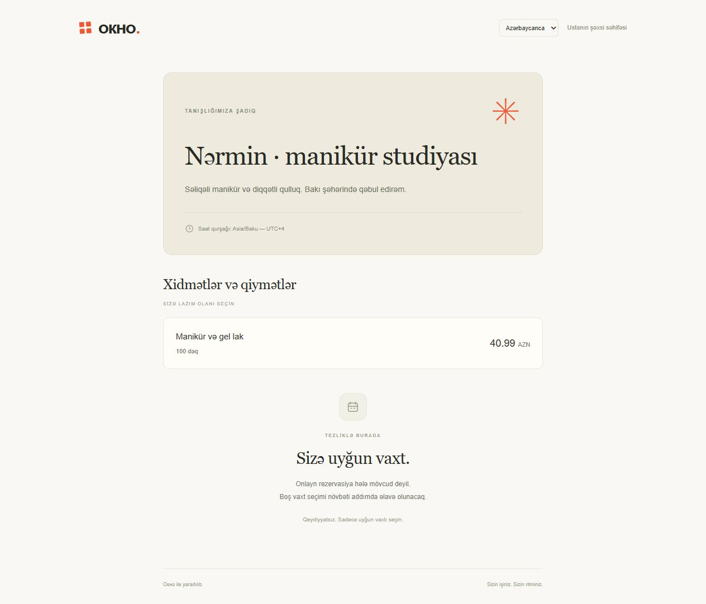

## Расписание мастера

Семь переключателей рабочих дней, часы начала и конца, один необязательный
перерыв в каждый день. На телефоне пары времени идут отдельными строками.
В боковой колонке — часовой пояс и разовые выходные по датам.
Выходные выбираются кликом в календаре с переключением месяцев. Выбранные даты
выделены оранжевым и показаны списком с кнопками удаления. Изменения применяются
после сохранения расписания; существующие записи не отменяются.

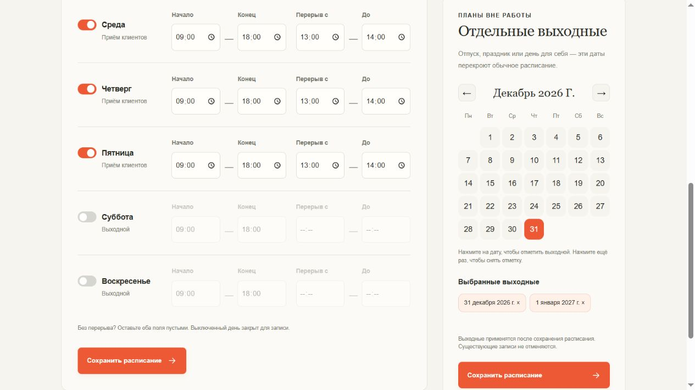
Время хранится в местном часовом поясе мастера; новые расписания закрыты.

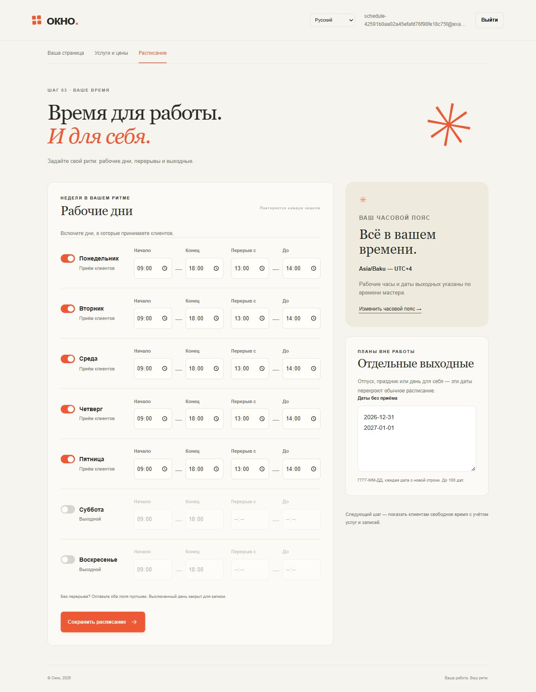

## Управление записями

Вкладки «Календарь», «Ближайшие» и «История», карточки с временем, клиентом,
услугой и ценой. Отмена раскрывается внутри карточки с дополнительной кнопкой
подтверждения. «Завершить визит» доступно после окончания, «Не пришёл» — после
начала. Ручная запись использует тот же календарь свободных окон.

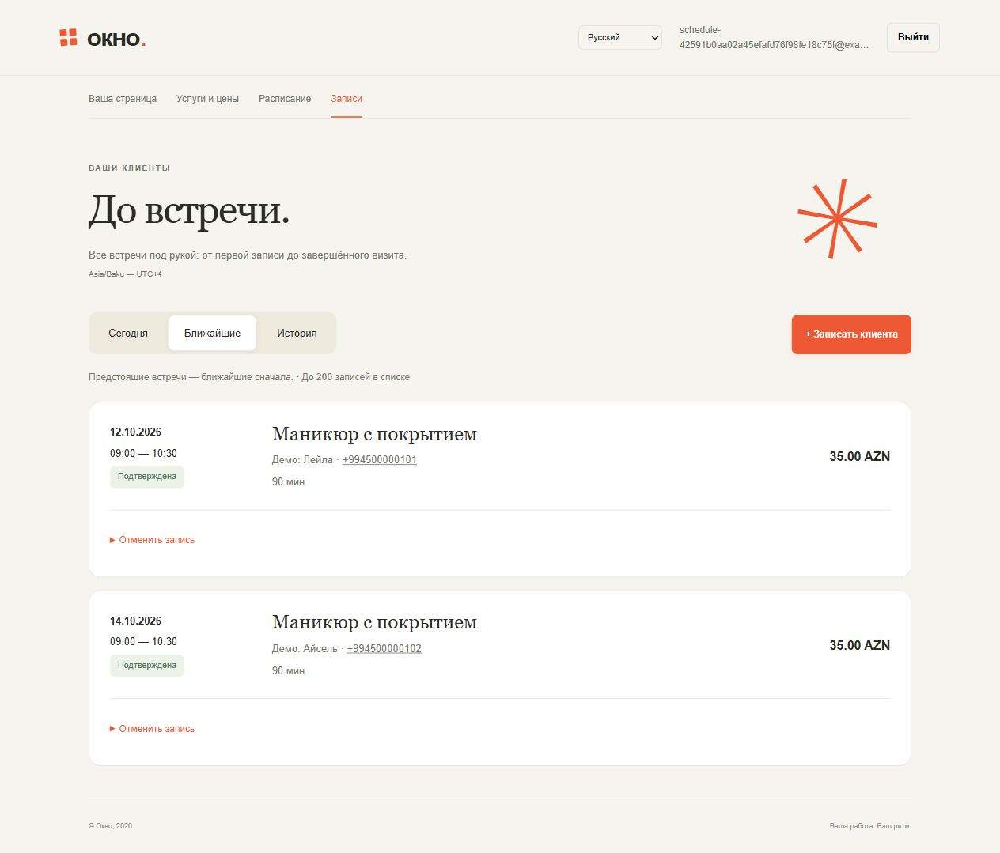
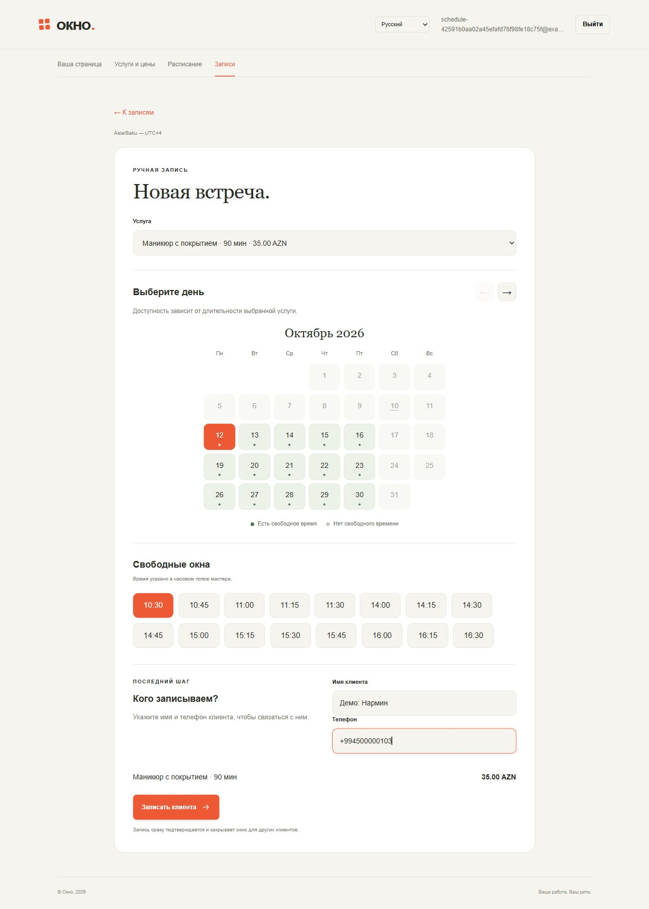

### Календарь рабочего дня

Выбран второй вариант из `concepts/okno-day-calendar.html`: недельная полоса
дат, шкала рабочего времени и карточка выбранного клиента. На шкале видны
рабочие часы, перерыв и действующие записи. Отменённые визиты и неявки доступны
в списке дня, но не занимают время. По умолчанию открывается сегодняшний день
в часовом поясе мастера. После изменения статуса выбранная дата сохраняется.
На телефоне карточка располагается под календарём; нажатие на запись переносит
к её деталям. Без JavaScript карточки доступны по якорным ссылкам.

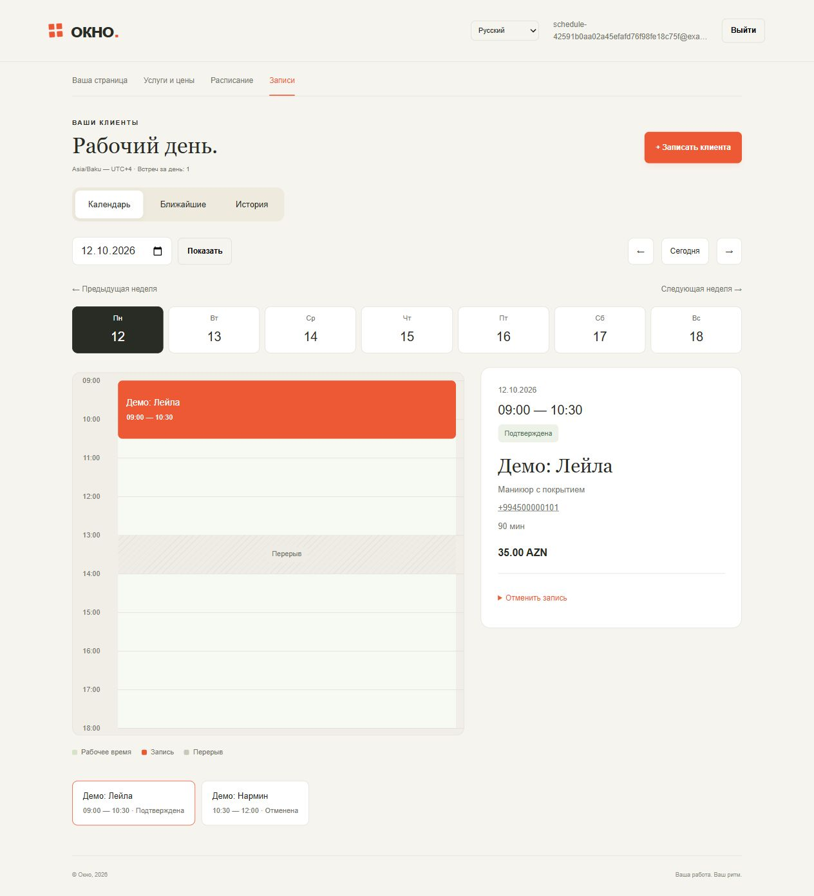
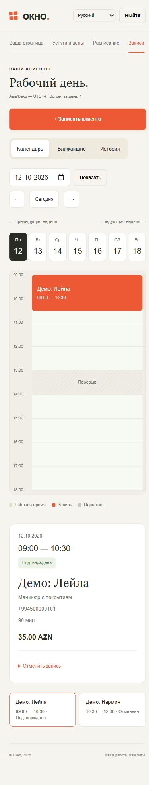

### Перенос записи

В карточке предстоящей подтверждённой встречи доступна кнопка «Перенести».
Форма показывает клиента, услугу, сохранённую цену и прежнее время. Ниже —
календарь доступных дней и свободные окна. После подтверждения открывается
новый день с выбранной записью. Мастер сообщает клиенту новый срок вручную;
существующая страница подтверждения показывает новое время.

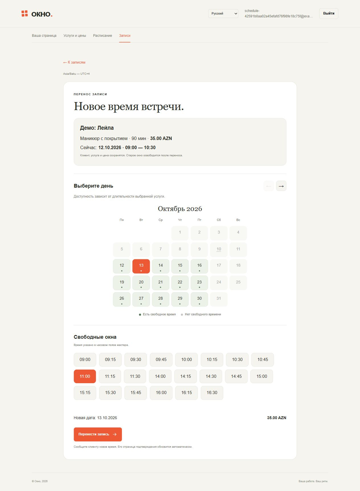
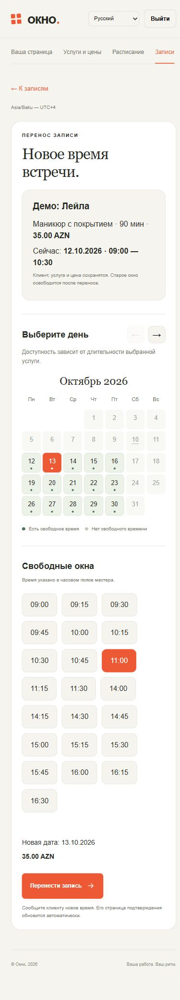

## Онлайн-запись клиента

Публичная страница: услуга и дата, свободные окна, имя и телефон,
стоимость и подтверждение. Выбранное время выделяется оранжевым.
На телефоне поля идут в одну колонку. Подтверждение показывает дату,
время и сохранённую стоимость; имя и телефон доступны только мастеру.

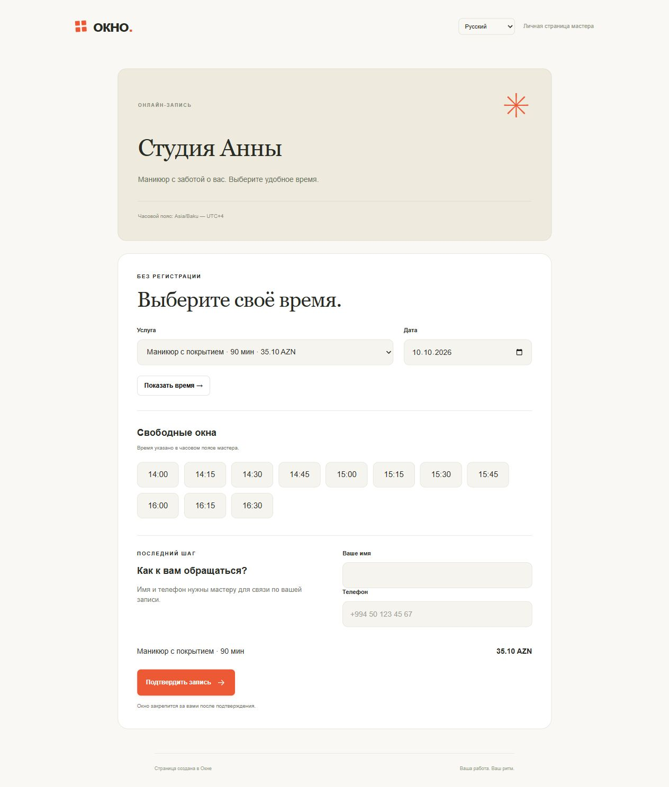
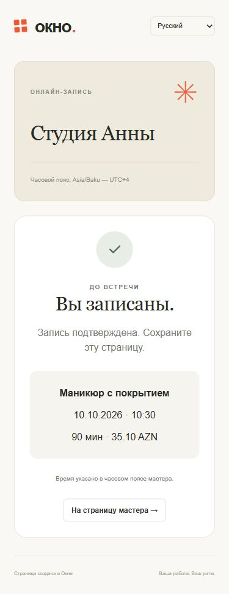

### Сопровождение подтверждённой записи — U3

Концепция расширяет подтверждение записи местом встречи, правилами отмены,
динамическим набором опубликованных контактов мастера и главным действием
«Добавить в календарь». Текстовый адрес и необязательные координаты разделены,
чтобы не связывать модель с конкретным поставщиком карт и дать мастеру контроль
над точностью публичного места. Телефон, WhatsApp, Telegram и Instagram
показываются только при наличии соответствующей настройки.

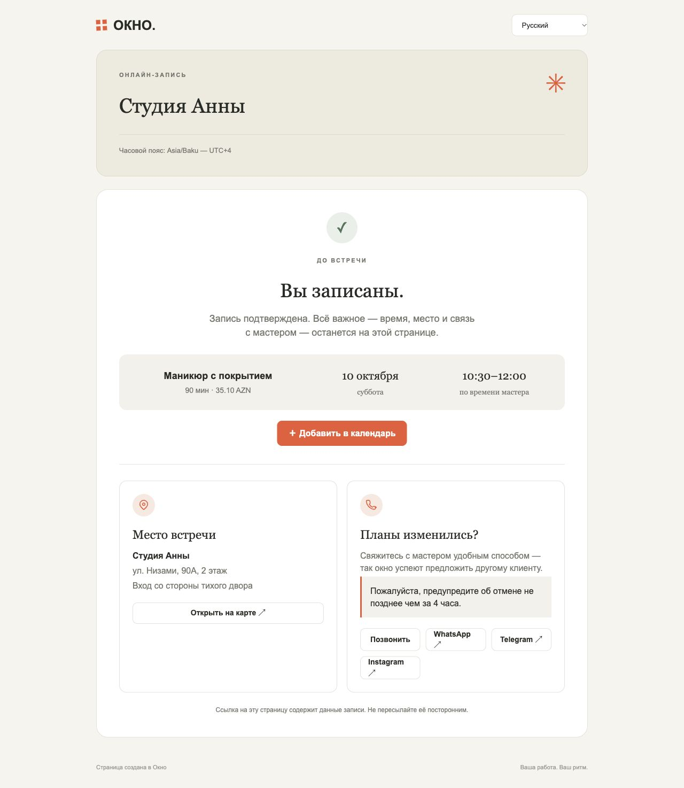
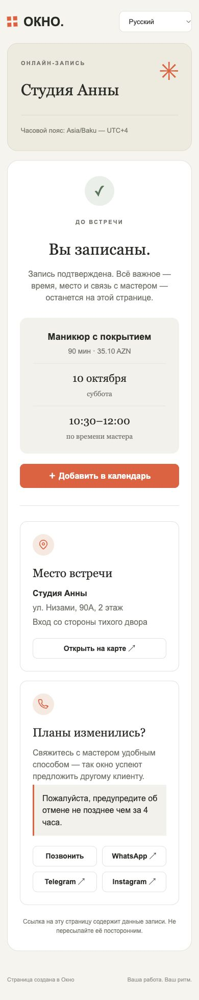

### Календарь доступных дней

Зелёные дни имеют хотя бы одно окно для выбранной услуги. Серые даты недоступны,
выбранный день выделен оранжевым. Календарь начинается с понедельника и покрывает
ближайшие 60 дней; стрелки переключают месяцы. При смене услуги он пересчитывается.
Без JavaScript доступны все месяцы и кнопка обновления.

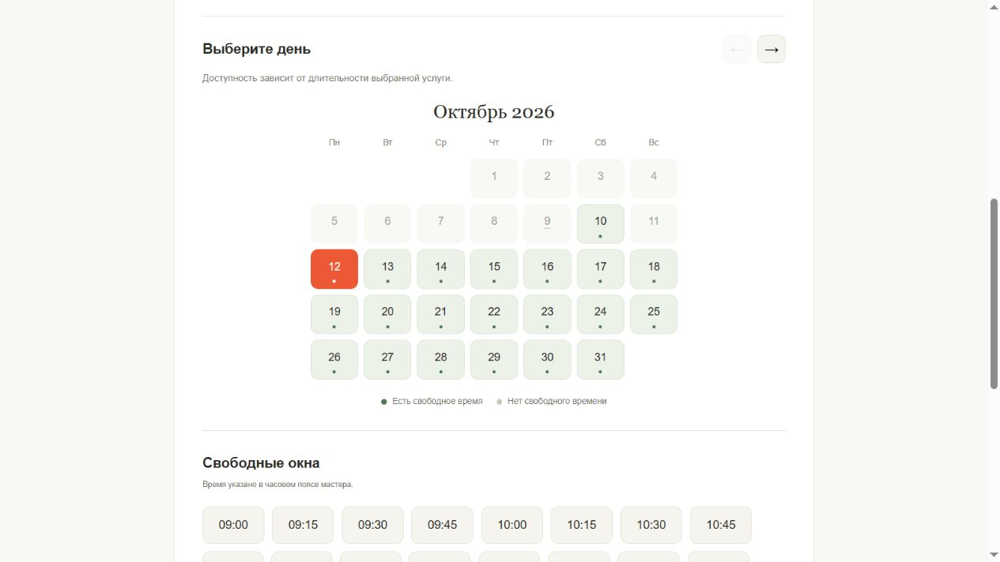
