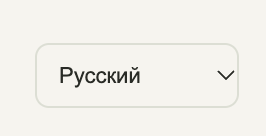
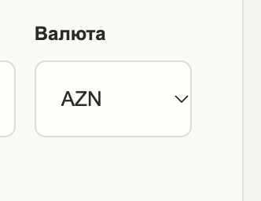
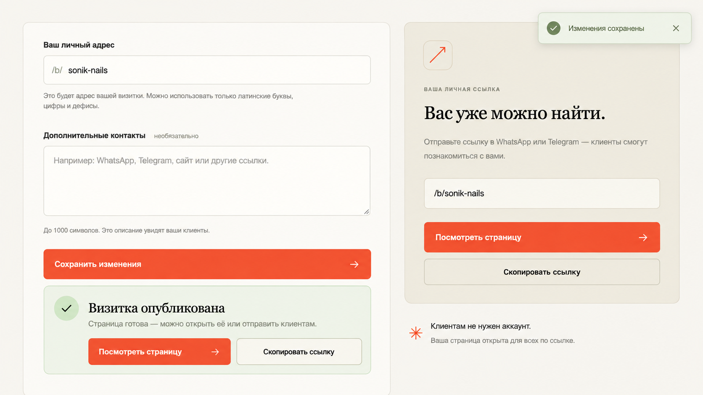
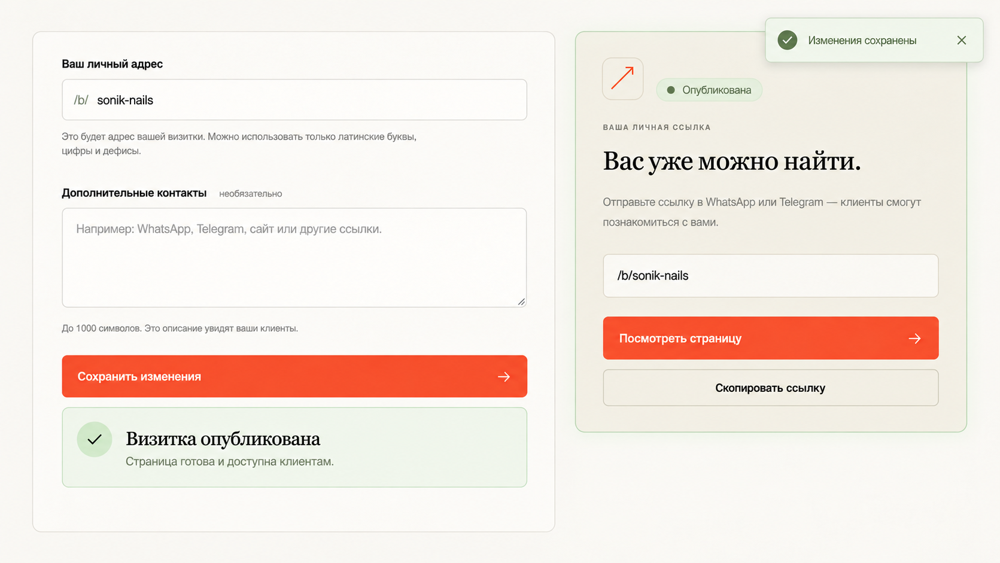
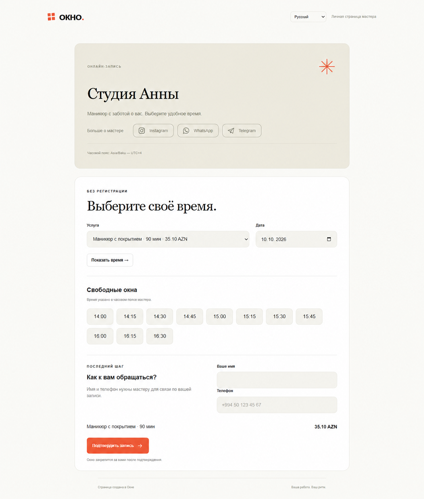

# UI changes — 2026-10-16

Этот каталог фиксирует визуальные решения, принятые 16 октября 2026 года.
Исходный код интерфейса остаётся в `frontend/`, а здесь хранятся контекст,
варианты и ссылки на затронутые файлы.

## Стрелки в выпадающих списках

### Проблема

Системная стрелка находилась слишком близко к правой границе языкового селекта
и поля валюты.

### Решение

- Используется единая SVG-стрелка.
- Для языкового селекта отступ справа составляет 12 px.
- Для селектов формы отступ справа составляет 14 px.
- Под текст зарезервировано место, чтобы он не пересекался со стрелкой.

До изменения:

Реализация: `frontend/static/style.css`.

## Расписание

### Нижние границы карточек

Белая карточка недельного расписания и белая карточка отдельных выходных
выровнены по нижней границе на широком экране. Поясняющий текст больше не
участвует в расчёте высоты карточек. На планшете и телефоне блоки сохраняют
естественную высоту.

### Подсказка об отдельных выходных

Отдельная подпись под карточкой удалена. Подсказка перенесена внутрь карточки,
перед кнопкой сохранения:

> Выбранные даты будут закрыты для новых онлайн-записей. Существующие записи не изменятся.

Реализация: `frontend/templates/schedule.html`, `frontend/static/style.css`,
`frontend/locales/en.json`, `frontend/locales/az.json`.

## Публикация визитки

### Рассмотренный вариант v1

Первый вариант повторял действия «Посмотреть страницу» и «Скопировать ссылку»
в уведомлении и в правой карточке.

### Выбранный вариант v2

Роли элементов разделены:

- под кнопкой формы показывается только подтверждение публикации;
- действия остаются только в правой карточке;
- правая карточка получает статус «Опубликована» и временную мягкую подсветку;
- небольшой toast подтверждает сохранение и исчезает через 5 секунд;
- после первого создания страница возвращается к области действий формы;
- последующие сохранения показывают только toast.

Реализация: `backend/internal/http/handlers/business.go`,
`frontend/templates/cabinet.html`, `frontend/static/style.css`,
`frontend/static/app.js`, `frontend/locales/en.json`,
`frontend/locales/az.json`.

## Соцсети на публичной странице — концепция v1

Instagram, WhatsApp и Telegram размещены компактной вторичной строкой внутри
карточки мастера. Нейтральные контурные кнопки помогают изучить работы или
связаться с мастером, но не конкурируют с основной онлайн-записью.

Статус: концепция, ещё не реализована в интерфейсе.

## Черновик контактов записи — U1

Имя и телефон больше не теряются, когда клиент или мастер меняет услугу либо
дату и форма загружается заново.

- черновик хранится только в `sessionStorage` текущей вкладки и не передаётся
  через URL или на сервер до отправки формы;
- срок жизни — 15 минут с последнего изменения;
- ключ разделён по публичной странице мастера и сценарию ручной записи;
- данные сервера имеют приоритет над черновиком при ошибке валидации;
- после успешного создания записи черновик удаляется;
- если хранилище браузера недоступно, форма продолжает работать без сохранения.

Реализация: `frontend/templates/online.html`,
`frontend/templates/booking-new.html`, `frontend/templates/bookings.html`,
`frontend/static/app.js`.

## Возврат к предыдущему варианту

История исходного кода должна сохраняться отдельными Git-коммитами. Этот каталог
позволяет определить нужный визуальный вариант, после чего соответствующий
коммит можно отменить или восстановить без догадок по описанию.

